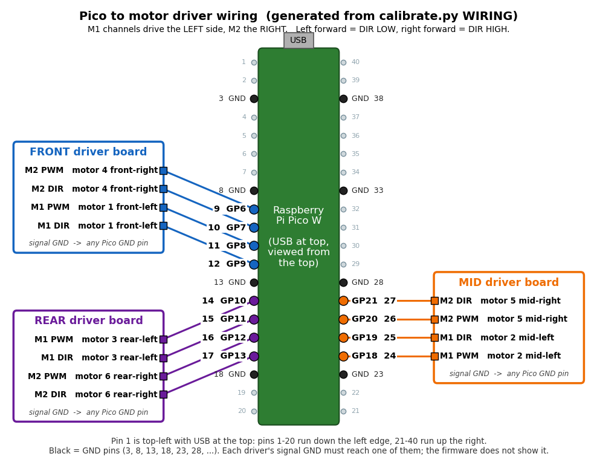

# athena_drive

Motor control subsystem for the Athena rover: converts ROS 2 `/cmd_vel` velocity commands into serial packets for a Raspberry Pi Pico W controlling 6 DC motors.

---

## Safety Guidelines

> [!CAUTION]
> **Keep wheels off the ground during testing.** Always prop up the rover on a bench for motor tests (except calibration stage 4 and topspeed tests which drive on the floor). A reversed motor found in the air is trivial to fix; on the floor it causes runaway motion.

- **Serial Port Exclusivity:** The Raspberry Pi Pico W serial port (`/dev/serial/by-id/usb-Raspberry_Pi_Pico*`) can be held by only **one process** at a time.
  - `bringup.launch.py` already includes `motor_bridge`.
  - To run calibration tools, stop bringup first.
  - Check which process holds the port:
    ```bash
    fuser -v /dev/ttyACM*
    ```
- **Failsafe Watchdogs:**
  - `motor_bridge` zeroes motor velocities if `/cmd_vel` stops arriving for >0.5 seconds.
  - Pico firmware stops all motor PWM if serial data is silent for >500 ms.
  - Unplugging the Pico's USB cable provides an immediate hardware emergency stop.

---

## Quick Start

```bash
# 1. Check serial port is free
fuser -v /dev/ttyACM*

# 2. Run the interactive calibration wizard (wheels elevated!)
ros2 run athena_drive calibrate

# 3. Launch motor bridge standalone (without full navigation)
ros2 launch athena_drive drive.launch.py

# 4. Keyboard teleop (arrows drive, space stops, releasing key halts)
ros2 run athena_drive teleop
```

---

## Pico Pinout & Wiring Map



Wiring connections between Raspberry Pi Pico W header pins and motor driver boards:

| Motor Channel | Location | Driver Channel | PWM Pin | DIR Pin | Forward DIR State |
|---|---|---|---|---|---|
| **Motor 1** | Front-Left | FRONT M1 | GP8 (Pin 11) | GP9 (Pin 12) | LOW |
| **Motor 2** | Mid-Left | MID M1 | GP18 (Pin 24) | GP19 (Pin 25) | LOW |
| **Motor 3** | Rear-Left | REAR M1 | GP10 (Pin 14) | GP11 (Pin 15) | LOW |
| **Motor 4** | Front-Right | FRONT M2 | GP6 (Pin 9) | GP7 (Pin 10) | HIGH |
| **Motor 5** | Mid-Right | MID M2 | GP20 (Pin 26) | GP21 (Pin 27) | HIGH |
| **Motor 6** | Rear-Right | REAR M2 | GP12 (Pin 16) | GP13 (Pin 17) | HIGH |

> [!NOTE]
> - Ground reference: Each motor driver GND must connect to a Pico GND pin (pins 3, 8, 13, 18, 23, or 28).
> - Configuration sync: Firmware pin `#define` statements in `firmware/athena_drive_fw/athena_drive_fw.ino` match `athena_drive/calibrate.py`.

---

## Motor Calibration Wizard

Run the interactive calibration wizard:
```bash
ros2 run athena_drive calibrate
```

### Menu Options
| Key | Action | Notes |
|---|---|---|
| `m` | **Manual motor test** | Select individual motors and test forward/reverse rotation |
| `d` | **Direction check** | Verify that left wheels spin forward on LOW and right on HIGH |
| `w` | **Wiring map** | Display the pinout table in the terminal |
| `s` | **Board status** | Query Pico firmware version and invert flags |
| `1` | **Stage 1: Directions** | Automated direction verification |
| `2` | **Stage 2: Side check** | Verify left side vs right side synchronization |
| `3` | **Stage 3: PWM Deadband** | Finds `min_pwm` required to overcome static motor friction |
| `4` | **Stage 4: Top Speed** | Measures `max_wheel_speed` (**drives on floor!**) |
| `5` | **Stage 5: Track Width** | Calibrates effective turning diameter |
| `a` | **Run All Stages** | Sequential run of stages 1 through 5 |

Non-interactive stage execution:
```bash
ros2 run athena_drive calibrate --ros-args -p stages:=3,4
```

Calibrated values are saved permanently to `~/.config/athena_drive/params.yaml`.

---

## Node & Executable Reference

| Node | Purpose | Port Required |
|---|---|---|
| `motor_bridge` | Main runtime bridge: translates `/cmd_vel` to Pico serial commands | Yes |
| `calibrate` | Interactive calibration wizard and parameter generator | Yes |
| `wiring_check` | Scripted diagnostic motor pulses for hardware debugging | Yes |
| `calibrate_speed` | Standalone benchmark tool for `min_pwm` and `max_wheel_speed` | Yes |
| `teleop` | Terminal keyboard teleop with auto-stop on key release | No |

---

## Key Parameters (`motor_bridge`)

Parameters loaded from `~/.config/athena_drive/params.yaml` or passed via launch arguments:

| Parameter | Default | Meaning |
|---|---|---|
| `track_width` | `0.85` | Distance in meters between left and right wheel track centers |
| `max_wheel_speed` | `0.70` | Maximum linear wheel speed in m/s at 100% PWM |
| `min_pwm` | `20` | Minimum PWM value to overcome static friction deadband |
| `max_pwm` | `255` | Upper PWM ceiling (lower to 120-150 for conservative testing) |
| `max_accel` | `0.5` | Maximum linear acceleration (m/s²) |
| `max_jerk` | `1.0` | Slew rate limit on acceleration changes (m/s³) |
| `port` | `""` | USB serial port (empty string auto-detects Pico by USB ID) |

---

## Documentation Links

- [Calibration Guide](docs/CALIBRATION.md)
- [Pico Firmware Documentation](docs/FIRMWARE.md)
- [Motor Bridge Kinematics & Protocols](docs/MOTOR_BRIDGE.md)
- [Drive Testing Procedures](docs/TESTING.md)
- [System Architecture](../docs/ARCHITECTURE.md)
