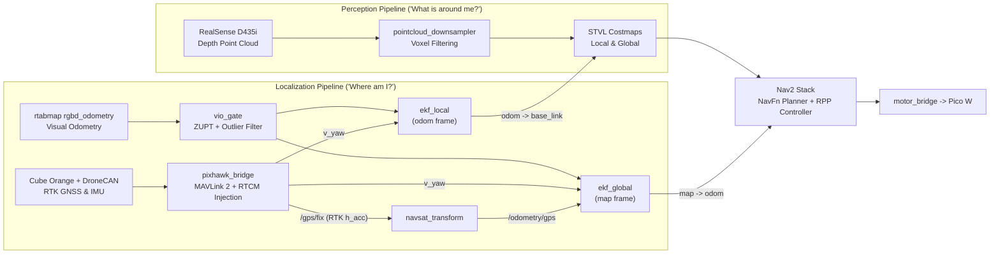
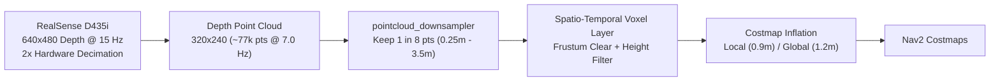
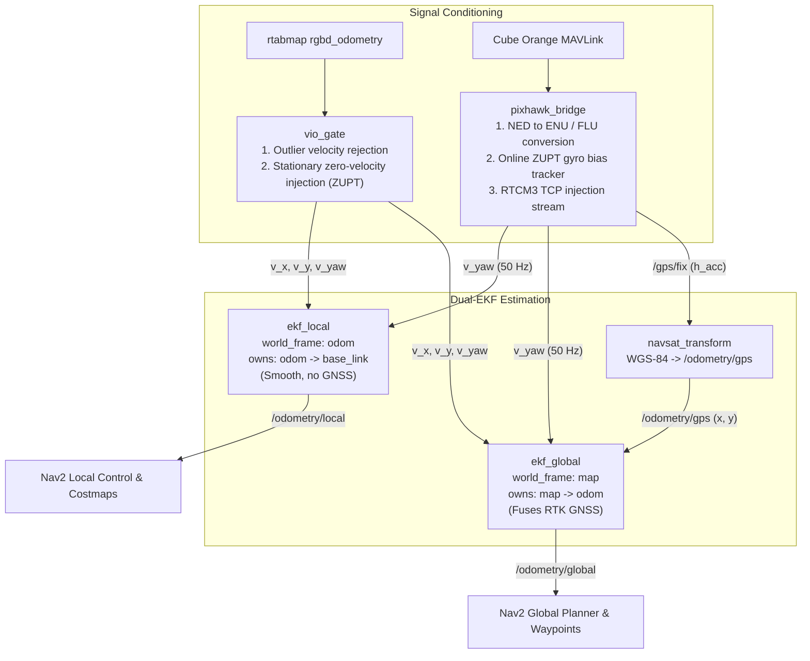
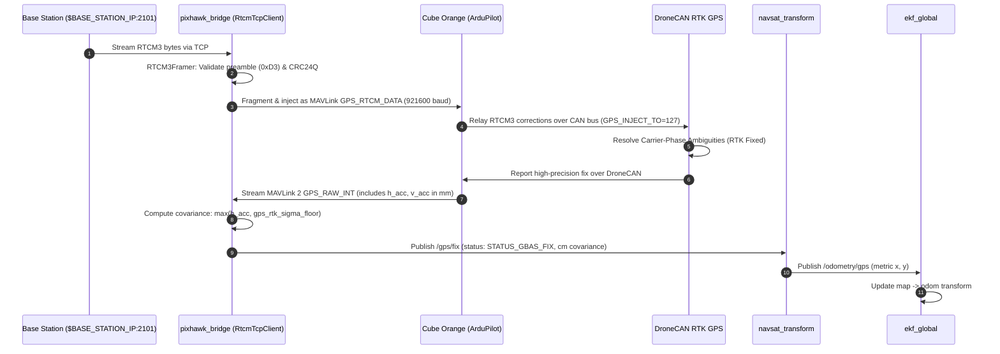
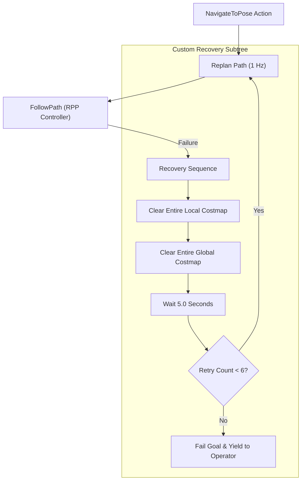

# Athena Navigation Architecture

Comprehensive architectural documentation for the `athena_gps_nav` package: sensor pipelines, state estimation, RTK GNSS injection, costmaps, and path planning.

For operational commands, see [README.md](README.md).  
For parameter tuning and field testing, see [docs/TUNING.md](docs/TUNING.md) and [docs/TESTING.md](docs/TESTING.md).

---

## Table of Contents

1. [Big Picture Architecture](#1-big-picture-architecture)
2. [Obstacle Perception Pipeline (Depth to Costmap)](#2-obstacle-perception-pipeline)
3. [Sensor Geometry & Extrinsics](#3-sensor-geometry--extrinsics)
4. [State Estimation Pipeline (Dual-EKF + RTK GNSS)](#4-state-estimation-pipeline)
5. [RTK GNSS Integration Architecture](#5-rtk-gnss-integration-architecture)
6. [Indoor Mode (`local_only:=true`)](#6-indoor-mode-local_onlytrue)
7. [Path Planning & Motion Control](#7-path-planning--motion-control)
8. [Behavior Trees & Recovery Strategies](#8-behavior-trees--recovery-strategies)
9. [Package Node & Tool Reference](#9-package-node--tool-reference)
10. [Verified Performance Metrics](#10-verified-performance-metrics)

---

## 1. Big Picture Architecture

Athena decomposes mobile autonomy into two isolated sensing chains that converge strictly inside the **Nav2** planning server:



> [!NOTE]
> **Fault Isolation:** If GNSS reception is lost (e.g. driving under dense tree cover or indoors), the local odometry filter (`odom -> base_link`) and obstacle avoidance costmaps continue operating with zero degradation or discontinuity.

---

## 2. Obstacle Perception Pipeline

The Intel RealSense D435i serves as Athena's sole environmental obstacle sensor (no LiDAR).



### Perception Specifications & Layers

| Stage | Node / Layer | Parameters | Function |
|---|---|---|---|
| **Acquisition** | `realsense2_camera_node` | Profile: `640x480x15`<br/>Decimation: 2x (`320x240`) | Captures aligned depth and color streams. Driver decimation reduces processing overhead by 75% on the Jetson CPU. |
| **Downsampling** | `pointcloud_downsampler` | `scarcity: 8`<br/>`min_dist: 0.25 m`<br/>`max_dist: 3.5 m` | Reduces ~77,000 raw points down to ~4,300 points @ 7.4 Hz. Discards self-hits on the rover chassis (<0.25 m). |
| **Voxel Marking** | `stvl_layer (realsense_mark)` | `filter: passthrough`<br/>`min_obstacle_height: 0.10 m`<br/>`max_obstacle_height: 1.8 m` | Maps 3D obstacles into 3D voxel space. `0.10 m` in the costmap frame equates to `0.20 m` above ground level (since `base_link` is at z=0.10 m). |
| **Frustum Clearing** | `stvl_layer (realsense_clear)` | `vertical_fov_angle: 1.05`<br/>`horizontal_fov_angle: 1.17`<br/>`decay_acceleration: 10 (loc), 5 (glob)` | Raytraces the active camera view frustum. Any voxel within the current FOV not re-marked by a new point is erased within ~1.0 s. |
| **Costmap Decay** | Local vs Global STVL | Local: `decay_model: 0` (30 s expiry)<br/>Global: `decay_model: -1` (persistent) | Local map bounds unobserved history. Global map preserves obstacle boundaries beyond FOV until cleared by direct observation. |

> [!IMPORTANT]
> **Safety Guard (`expected_update_rate: 2.0`):** Both costmap observation sources enforce a 2.0-second watchdog. If camera point clouds stop arriving for >2.0 s, the costmap marks itself stale and Nav2 immediately halts the rover.

---

## 3. Sensor Geometry & Extrinsics

All spatial transforms are declared in `urdf/athena.urdf.xacro`. The costmap and EKF treat these values as authoritative ground truth:

| Transform | Value $(x, y, z)$ | RPY $(\text{roll}, \text{pitch}, \text{yaw})$ | Verification Method |
|---|---|---|---|
| `base_link -> camera_link` | `(0.50, 0.00, 0.55)` m | `(0.0, 0.0, 0.0)` rad | Verified via tape measure and RANSAC plane fitting (`mount_check.py camera`: pitch -1.25°, roll +0.52°). |
| `base_link -> imu_link` | `(0.50, 0.00, 0.40)` m | `(0.0, 0.0, 0.0)` rad | Cube Orange flight controller mounting orientation aligned with chassis forward. |
| `base_link -> gps_link` | `(0.00, 0.00, 0.25)` m | `(0.0, 0.0, 0.0)` rad | DroneCAN RTK GNSS antenna phase center location. |
| `base_link -> base_footprint` | `(0.00, 0.00, -0.10)` m | `(0.0, 0.0, 0.0)` rad | Ground projection plane beneath chassis center. |

```
Transform Hierarchy:
map (ekf_global)
 └─ odom (ekf_local)
     └─ base_link
         ├─ base_footprint
         ├─ camera_link -> camera_camera_link
         ├─ imu_link
         ├─ gps_link
         └─ wheel_{front,mid,rear}_{left,right}
```

---

## 4. State Estimation Pipeline

Athena integrates three complementary sensing modalities through a dual-EKF setup (`robot_localization`):

| Modality | Strengths | Weaknesses | Role in Stack |
|---|---|---|---|
| **Visual Odometry (`rtabmap`)** | High precision, smooth, short-term trajectory tracking. | Long-term drift; sensitive to featureless environments. | Provides high-frequency linear/angular velocities to both EKFs. |
| **Cube Orange Gyro (`pixhawk_bridge`)** | Fast, high-frequency rotational dynamics (50 Hz). | Accelerometer vibration; magnetometer uncalibrated. | Provides yaw rate ($v_{yaw}$) to both EKFs; stationary ZUPT bias correction. |
| **DroneCAN RTK GNSS (`pixhawk_bridge`)** | Centimeter-level absolute global coordinates (no drift). | 5 Hz update rate; requires satellite sky view and RTCM corrections. | Corrects absolute position in global EKF (`map -> odom`). |



### Key Estimator Design Principles

1. **Dual-Filter Decoupling:**
   - **`ekf_local` (`odom -> base_link`):** Fuses only continuous odometry (VIO velocities + IMU yaw rate). Never receives GNSS data. Guarantees a jump-free pose for the local controller and local costmap.
   - **`ekf_global` (`map -> odom`):** Fuses VIO velocities, IMU yaw rate, and `/odometry/gps`. Any position corrections from RTK GNSS are absorbed entirely into the `map -> odom` transform.
2. **Velocity-Only VIO Ingestion:** VIO is fused as linear velocities ($v_x, v_y, v_{yaw}$) rather than position $(x, y, yaw)$. If feature tracking drops and resets, no position discontinuities propagate into the filter.
3. **Physical Gating vs Mahalanobis Gating:** Standard covariance gating (`odom0_twist_rejection_threshold`) is disabled in the YAML because single outliers cause filter self-locking. Outlier velocities (>1.5 m/s) are explicitly filtered in physical units by `vio_gate.py`.
4. **Gyro Rate Fusion Only:** Absolute orientation from the flight controller attitude estimate is excluded (`imu0_config` index 5 is `false`). Only angular rate $v_{yaw}$ (index 11) is fused. Global heading aligns naturally with the RTK GNSS motion vector.

---

## 5. RTK GNSS Integration Architecture

Athena achieves centimeter-accurate positioning by integrating real-time RTCM3 differential corrections with the Cube Orange and DroneCAN GNSS receiver.



### Component Details & Parameters

#### 1. Base Station Streamer
- **Protocol:** Raw RTCM3 over TCP server.
- **Typical Producers:** STRSVR, `str2str` (RTKLIB), or an NTRIP client relaying from a local CORS caster.
- **Port:** `2101` (standard).
- **Environment Variables:** `pixhawk_bridge.py` resolves the server address via `$RTCM_HOST` or `$BASE_STATION_IP` (falling back to `127.0.0.1`).

#### 2. `pixhawk_bridge.py` & `rtcm.py`
- Runs `RtcmTcpClient` in a background thread with automatic TCP reconnect.
- Uses `RTCM3Framer` to scan for preamble `0xD3` and verify 24-bit CRC24Q checksums.
- Fragments frames into chunks $\le 180$ bytes and transmits them as MAVLink `GPS_RTCM_DATA` (message ID 233) over the primary serial telemetry link.
- Shares a serial TX lock (`_tx_lock`) to guarantee message atomicity between stream requests and RTCM injection packets.

#### 3. Flight Controller Parameters (Cube Orange / ArduPilot)
- `GPS_INJECT_TO = 127`: Injects incoming MAVLink RTCM corrections to all detected GNSS receivers.
- `GPS1_TYPE = 9`: Configures GPS 1 as a DroneCAN GNSS module.
- `MAVLINK20 = 1`: Enables MAVLink 2 protocol framing, mandatory for receiving `GPS_RAW_INT` extension fields `h_acc` and `v_acc`.
- `SERIALx_BAUD = 921` (921600 baud): High-speed USB telemetry link prevents buffer overrun.

#### 4. Dynamic Covariance Calculation
`pixhawk_bridge` dynamically computes the diagonal elements of `NavSatFix.position_covariance`:

$$\text{Horizontal Standard Deviation } \sigma_h = 
\begin{cases} 
\max\left(\frac{h_{acc}}{1000}, \sigma_{rtk\_floor}\right) & \text{if } fix\_type \ge 4 \text{ and } h_{acc} > 0 \\ 
\sqrt{(\text{HDOP} \times \text{uere})^2 + \sigma_{floor}^2} & \text{otherwise (Autonomous GPS)} 
\end{cases}$$

- `gps_rtk_sigma_floor`: Defaults to **`0.02 m`** (2 cm floor). Clamps covariance to prevent infinite EKF weighting.
- `gps_uere`: Defaults to **`1.74`**.
- `gps_sigma_floor`: Defaults to **`3.06 m`**.

```python
# Covariance matrix formulation in pixhawk_bridge.py
if msg.fix_type >= 4 and h_acc > 0.0:
    sh = max(h_acc, self._rtk_floor)
    sv = max(v_acc, 2.0 * self._rtk_floor) if v_acc > 0.0 else 2.0 * sh

fix.position_covariance = [
    sh * sh, 0.0,     0.0,
    0.0,     sh * sh, 0.0,
    0.0,     0.0,     sv * sv
]
fix.position_covariance_type = NavSatFix.COVARIANCE_TYPE_APPROXIMATED
```

#### 5. NavSatStatus Mapping
- `fix_type >= 5` (RTK Float / Fixed) $\to$ `NavSatStatus.STATUS_GBAS_FIX` (value `2`)
- `fix_type == 4` (DGPS) $\to$ `NavSatStatus.STATUS_SBAS_FIX` (value `1`)
- `fix_type == 3` (3D Fix) $\to$ `NavSatStatus.STATUS_FIX` (value `0`)
- `fix_type < 3` $\to$ `NavSatStatus.STATUS_NO_FIX` (value `-1`)

---

## 6. Indoor Mode (`local_only:=true`)

When operating in environments without GPS sky view, launch bringup with:

```bash
ros2 launch athena_gps_nav bringup.launch.py local_only:=true
```

### Architecture in Local-Only Mode

```
map === odom (Static Identity Transform)
 └─ base_link (ekf_local)
```

1. **Node Deactivation:** `ekf_global` and `navsat_transform` are disabled.
2. **Static Transform:** `tf2_ros` publishes a static identity `map -> odom` transform.
3. **Prevention of Numerical Drift:** Running two filters on identical sensor inputs without an absolute reference causes mathematical divergence between the two instances. Local-only mode ensures `map` and `odom` remain permanently identical.
4. **Nav2 Transparency:** Nav2 continues planning against `global_frame: map` without modifying parameter files.

---

## 7. Path Planning & Motion Control

### Planner & Controller Configuration

- **Global Planner:** **NavFn** (`use_astar: false`, Dijkstra algorithm). Operates on the 100x100 m global rolling costmap.
- **Local Controller:** **Regulated Pure Pursuit (RPP)**. Chosen for computational efficiency on the Jetson CPU.
- **Fixed Lookahead Distance:**
  - `lookahead_dist: 1.0 m` (Fixed).
  - `use_velocity_scaled_lookahead_dist: false`.
  > [!IMPORTANT]
  > Velocity-scaled lookahead computes $L = \text{clamp}(|v_x| \cdot t_{lookahead}, L_{min}, L_{max})$. At goal start, $v_x = 0$, pinning the carrot to $L_{min}$ (0.4 m), which falls **inside** Athena's 0.65 m chassis footprint. The controller interpreted this as an unachievable angular deviation and turned in place indefinitely. Fixed 1.0 m lookahead resolves this issue.
- **Odometry Topic Resolution:**
  All Nav2 nodes (`bt_navigator`, `controller_server`, `velocity_smoother`) explicitly subscribe to `/odometry/local`.

---

## 8. Behavior Trees & Recovery Strategies

Athena executes a custom Nav2 behavior tree located at `behavior_trees/athena_nav_to_pose.xml`:



### Removal of `Spin` and `BackUp` Actions
- **Asymmetric Sensing:** The RealSense D435i provides an 87° forward horizontal field of view. The rover has zero rear-facing sensors.
- Stock `Spin` rotates the rover through 273° of blind space.
- Stock `BackUp` reverses a 1.3 m chassis blindly into unchecked space.
- Both actions were purged from the behavior tree. The system relies strictly on costmap clearing, brief pausing, and clean failure reporting.

---

## 9. Package Node & Tool Reference

### Persistent Nodes

| Node Name | Source File | Description |
|---|---|---|
| `pixhawk_bridge` | `pixhawk_bridge.py` | Bridges Cube Orange MAVLink 2 telemetry (IMU + RTK GNSS), executes online ZUPT gyro bias estimation, and injects RTCM3 TCP corrections. |
| `vio_gate` | `vio_gate.py` | Validates VIO linear velocities against kinematic ceilings and forces exact zero velocities with low covariance during stationary intervals. |
| `pointcloud_downsampler` | `pointcloud_downsampler.py` | Voxel downsampler that thins RealSense point clouds to maintain real-time costmap updates on Jetson. |

### Diagnostic & Operational CLI Tools

| Command | File | Usage |
|---|---|---|
| `ros2 run athena_gps_nav stack_check` | `stack_check.py` | Automated multi-point health check verifying topic rates, IMU physics, transform chains, and EKF health. |
| `ros2 run athena_gps_nav gps_diagnose` | `gps_diagnose.py` | Serial diagnostic tool for GNSS status. Supports `--rtcm-host` and `--rtcm-port` for standalone RTK injection testing. |
| `ros2 run athena_gps_nav tf_check` | `tf_check.py` | Validates transform orientation correctness, gravitational sign (+z in `base_link`), and optical frame conventions. |
| `ros2 run athena_gps_nav localization_monitor` | `localization_monitor.py` | Records state estimation drift, path length, and discontinuity metrics over a specified window. |
| `ros2 run athena_gps_nav costmap_drift_check` | `costmap_drift_check.py` | Verifies costmap stationary stability. |
| `ros2 run athena_gps_nav gps_waypoint_logger` | `gps_waypoint_logger.py` | Records real-world RTK coordinates into waypoint YAML files. |
| `ros2 run athena_gps_nav gps_waypoint_follower` | `gps_waypoint_follower.py` | Iterates through waypoint lists, transforms lat/lon via `/fromLL`, and dispatches goals to Nav2. |

---

## 10. Verified Performance Metrics

Quantitative benchmarks verified on the physical Athena platform:

### 1. Localization & RTK Precision

| Operating Mode | Horizontal Accuracy ($1\sigma$) | Maximum Wander | Nav2 Goal Tolerance |
|---|---|---|---|
| **RTK Fixed (`fix_type=6`)** | **0.015 – 0.030 m (1.5 – 3.0 cm)** | < 0.04 m | `xy_goal_tolerance: 0.15 m` |
| **RTK Float (`fix_type=5`)** | **0.150 – 0.400 m (15 – 40 cm)** | < 0.60 m | `xy_goal_tolerance: 0.40 m` |
| **Autonomous GPS (`fix_type=3`)** | **3.50 m (Stationary 240 s)** | ~10.5 m | `xy_goal_tolerance: 0.50 – 1.0 m` |

### 2. Operational Topic Frequencies

| Component | Target Frequency | Measured Output | Status |
|---|---|---|---|
| Cube Orange IMU (`/imu/data`) | 50.0 Hz | 39.2 – 48.5 Hz | PASS |
| RTK GNSS Fix (`/gps/fix`) | 5.0 Hz | 5.0 Hz | PASS |
| Depth Point Cloud (Downsampled) | 7.0 Hz | 7.4 Hz | PASS |
| Visual Odometry (`/vio/odometry`) | 10.0 Hz | 9.7 – 11.2 Hz | PASS |
| Local EKF (`/odometry/local`) | 30.0 Hz | 19.5 – 26.0 Hz | PASS |
| Global EKF (`/odometry/global`) | 30.0 Hz | 19.5 – 26.0 Hz | PASS |
| Local Costmap (`/local_costmap/costmap`) | 2.0 Hz | 1.5 Hz | PASS |

### 3. Stationary Drift (150-second test window)

| Metric | Measured Value | Requirement |
|---|---|---|
| `/odometry/local` Displacement | **0.0 cm** | < 5.0 cm |
| Raw VIO Drift (Pre-ZUPT) | 0.00019 m/s | < 0.005 m/s |
| Local Costmap Spatial Drift | **0.7 cm total (0.4 cm/min)** | < 5.0 cm |
| Yaw Drift | **0.05° net** | < 1.0° |
