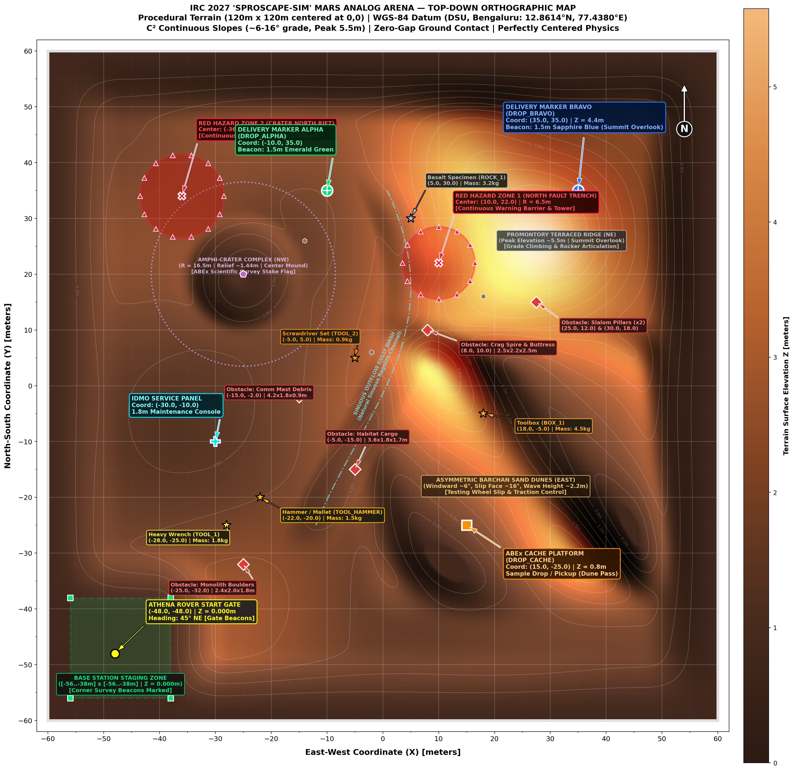
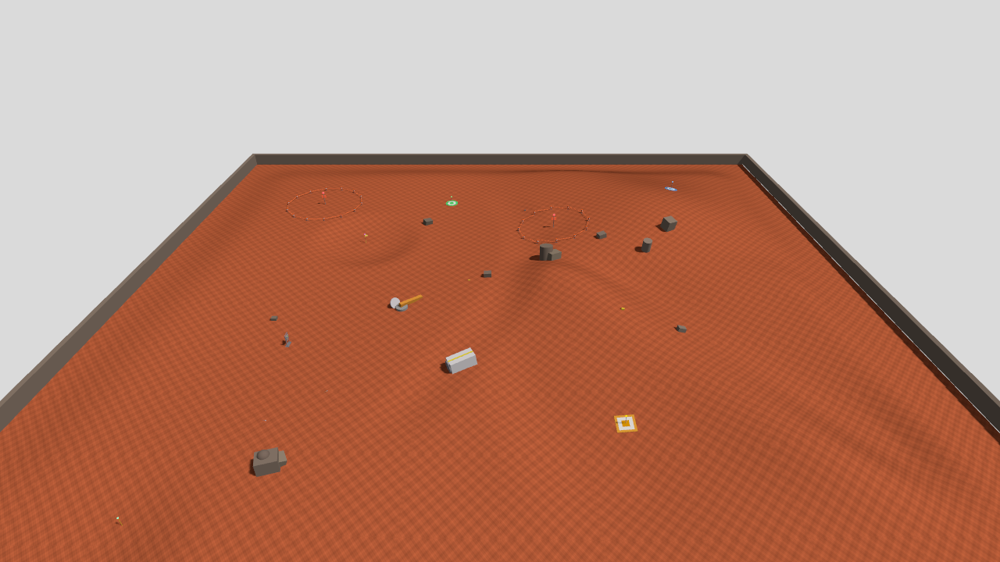
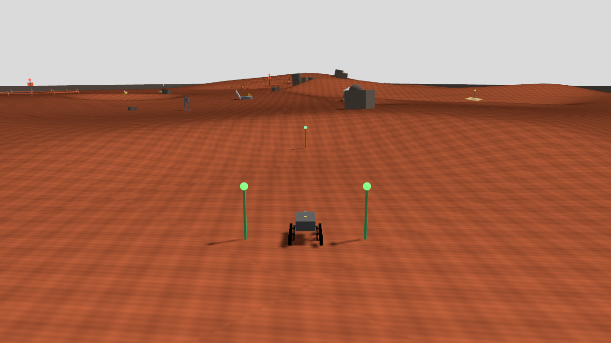
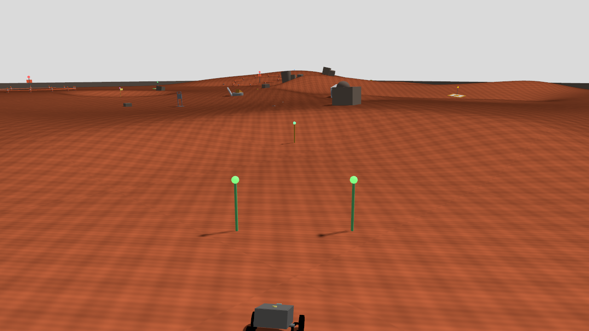
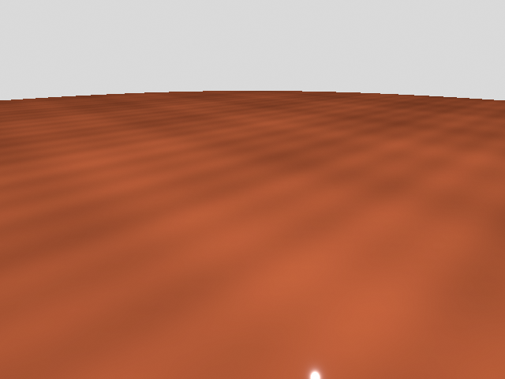

# athena_sim: Simulation Harness for Athena Rover (IRC 2027)

Comprehensive, plug-and-play simulation harness for the Athena rover in **Gazebo Sim** (Gazebo Harmonic 8.x / Gazebo Fortress 6.x) built for the **International Rover Challenge (IRC 2027)** finals at Dayananda Sagar University, Bengaluru.

The package provides an accurate Martian-analog competition arena (**Sproscape World**), multi-state RTK GNSS error modeling, Visual-Inertial Odometry drift emulation, Intel RealSense RGB-D sensor simulation, dual spectator arena cameras, and full integration with the rover's production autonomy stack (Dual EKF, Nav2, STVL 3D costmaps).

---

## Visual Showcase & Arena Overview

### 1. Orthographic Arena Mission Map
High-resolution 2D shaded-relief topographic map with $0.5\,\text{m}$ elevation contours, IRC competition waypoints, hazard zones, and metric grid:



### 2. Multi-Angle Simulation Views

| Arena Spectator Overview | Base Station Staging Area |
| :---: | :---: |
|  |  |
| *Spectator overview camera (`/arena/overview_camera/image_raw`) showing Martian topography, dunes, crater, and perimeter pylons.* | *Base station camera (`/arena/base_camera/image_raw`) showing Athena rover initialized on the flat landing pad.* |

| Rover Driving Action | Onboard Intel RealSense RGB-D Feed |
| :---: | :---: |
|  |  |
| *Athena rover navigating across natural Martian soil towards the Promontory Ridge.* | *Live onboard color stream (`/camera/camera/color/image_raw`) published by the RealSense D435 sensor.* |

---

## Arena & Topography Specifications

The simulation arena strictly adheres to IRC 2027 terrain guidelines:

- **Dimensions**: $120.0\,\text{m} \times 120.0\,\text{m}$, centered at natural Gazebo origin $(0.0, 0.0)$, spanning $X \in [-60.0, +60.0]\,\text{m}$ and $Y \in [-60.0, +60.0]\,\text{m}$.
- **Elevation Dynamic Range**: Procedural 16-bit Gaussian heightmap ($257 \times 257$ grid), $Z \in [0.000\,\text{m}, +5.578\,\text{m}]$.
- **Base Station Staging Pad**: Flat $12\,\text{m} \times 12\,\text{m}$ deployment zone at $(X=-48.0\,\text{m}, Y=-48.0\,\text{m}, Z=0.000\,\text{m})$, equipped with high-gain directional antenna tower, solar array, and telemetry station.
- **Promontory Terraced Ridge**: High rocky promontory reaching $+5.58\,\text{m}$ at $(X=18.0\,\text{m}, Y=24.0\,\text{m})$ with traversable switchback ramps and stepped terraces.
- **Amphi-Crater Complex**: Impact crater ($R = 16.5\,\text{m}$) at $(X=22.0\,\text{m}, Y=-20.0\,\text{m})$ with raised rim ($+0.85\,\text{m}$) and crater floor ($-1.25\,\text{m}$, true relief $1.44\,\text{m}$) containing the ABEX science survey stake.
- **Barchan Sand Dunes**: Transverse dune field at $(X=-22.0\,\text{m}, Y=26.0\,\text{m})$ with $+2.25\,\text{m}$ crests, gentle windward slope ($8^\circ$), and steep slip face ($16^\circ$).
- **Sinuous Wash Gully**: Erosion channel cutting diagonally across the arena floor ($Z \approx -0.40\,\text{m}$).
- **Red Zone (No-Go Contaminated Boundary)**: Enclosed polygon marked by 10 boundary pylons physically connected with continuous red hazard ribbons, placed at surface level without floating artifacts.

---

## System Requirements & Compatibility

| Component | Officially Supported | Minimum / Alternate |
| :--- | :--- | :--- |
| **Operating System** | Ubuntu 22.04 LTS (Jammy) | Ubuntu 20.04 / 24.04 (via Docker) |
| **ROS Distribution** | **ROS 2 Humble Hawksbill** | ROS 2 Iron / Rolling (requires manual bridge build) |
| **Gazebo Simulator** | **Gazebo Harmonic 8.x** (`gz sim`) | **Gazebo Fortress 6.x** (`ign gazebo`) |
| **Python** | Python 3.10+ | Python 3.8+ |
| **GPU / Acceleration** | OpenGL 3.3+ / Vulkan (NVIDIA / Intel DRI) | Software rendering via `LIBGL_ALWAYS_SOFTWARE=1` |

---

## One-Go Plug-and-Play Installation

To get `athena_sim` running from a clean machine or fresh repository clone:

### Step 1: Install System Dependencies via `rosdep`
From the root of your rover workspace (e.g. `~/Rover`):

```bash
cd ~/Rover

# 1. Update rosdep package index
rosdep update

# 2. Install all missing dependencies in one go
rosdep install --from-paths src --ignore-src -r -y
```

### Step 2: Run Pre-Flight Environment Diagnostic Check
Before building or launching, run the automated environment validator:

```bash
python3 src/athena_sim/athena_sim/check_env.py
```

The script audits:
- Host OS and glibc ABI compatibility.
- ROS 2 installation and `ROS_DISTRO=humble` configuration.
- Installed Gazebo simulator binary and engine version (Harmonic vs Fortress).
- Core ROS packages (`robot_state_publisher`, `xacro`, `tf2_ros`, `ros_gz_bridge`, `ros_gz_sim`).
- Python libraries (`numpy`, `PIL`, `pyyaml`, `matplotlib`).
- World assets, heightmap PNG, and 3D models integrity.
- GPU acceleration (`/dev/dri/renderD128`) and display availability.

If any dependency is missing or misconfigured, `check_env.py` displays detailed resolution steps and exact `apt` installation commands.

### Step 3: Build the Workspace
```bash
colcon build --packages-select athena_sim --symlink-install
source install/setup.bash
```

---

## Launching the Simulation

### 1. Full Autonomous Stack Bringup (Recommended)
Launches Gazebo, spawns Athena rover, starts the ROS-Gazebo parameter bridge, TF frames, Dual EKF localization, and RTK GNSS emulator:

```bash
ros2 launch athena_sim sim.launch.py
```

### 2. Headless Simulation (For CI, Servers, or Weak GPUs)
Disables the 3D GUI client while running the complete physics engine and publishing all camera, IMU, GPS, and odometry topics:

```bash
ros2 launch athena_sim sim.launch.py headless:=true
```

### 3. Lightweight Smoke Test
Spawns the rover and bridges basic sensors without Nav2:

```bash
ros2 launch athena_sim test_world.launch.py
```

### Launch Arguments Reference

| Argument | Default | Description |
| :--- | :--- | :--- |
| `world` | `sproscape.sdf` | Absolute path to the SDF world file. |
| `headless` | `false` | When `true`, runs simulation headless (`-s -r`) without GUI window. |
| `gui` | `true` | When `false`, disables Gazebo GUI interface. |
| `use_sim_time` | `true` | Sets ROS parameter `/use_sim_time` to match Gazebo simulation clock. |
| `spawn_x` | `-48.0` | Initial rover spawn X position (meters). |
| `spawn_y` | `-48.0` | Initial rover spawn Y position (meters). |
| `spawn_z` | `0.25` | Initial rover spawn Z position (meters). |
| `spawn_yaw` | `0.7854` | Initial rover yaw orientation ($45^\circ$, facing northeast). |

---

## ROS 2 Topics & Sensor Interface

### Actuation & Teleoperation
| Topic | Type | Description |
| :--- | :--- | :--- |
| `/cmd_vel` | `geometry_msgs/msg/Twist` | Velocity command driving the 6-wheel skid-steer chassis. |

### Odometry & Localization
| Topic | Type | Description |
| :--- | :--- | :--- |
| `/sim/odom` | `nav_msgs/msg/Odometry` | Ground-truth wheel odometry published by Gazebo DiffDrive plugin. |
| `/odometry/local` | `nav_msgs/msg/Odometry` | Fused local odometry (Wheel + IMU + VIO) from `ekf_local`. |
| `/odometry/global` | `nav_msgs/msg/Odometry` | Map-referenced odometry (Local + RTK GNSS) from `ekf_global`. |
| `/imu/data` | `sensor_msgs/msg/Imu` | 6-DOF IMU stream (linear acceleration & angular velocity) @ 100 Hz. |

### GNSS Navigation
| Topic | Type | Description |
| :--- | :--- | :--- |
| `/gps/fix_raw` | `sensor_msgs/msg/NavSatFix` | Raw ground-truth Gazebo NavSat data. |
| `/gps/fix` | `sensor_msgs/msg/NavSatFix` | Realistic RTK GNSS feed injected with covariance & mode transitions. |

### Vision & Cameras
| Topic | Type | Description |
| :--- | :--- | :--- |
| `/camera/camera/color/image_raw` | `sensor_msgs/msg/Image` | Onboard Intel RealSense D435 RGB color stream (640x480 @ 30 Hz). |
| `/camera/camera/depth/color/points`| `sensor_msgs/msg/PointCloud2` | 3D depth point cloud for STVL voxel grid obstacle costmaps. |
| `/arena/overview_camera/image_raw` | `sensor_msgs/msg/Image` | Spectator high-altitude arena overview camera (1280x720 HD). |
| `/arena/base_camera/image_raw` | `sensor_msgs/msg/Image` | Spectator base station camera (1280x720 HD). |

---

## Utility Scripts & CLI Tools

All utility scripts are registered as ROS 2 console scripts:

| Command | Description |
| :--- | :--- |
| `ros2 run athena_sim check_env` | Audits ROS, Gazebo, Python libraries, models, and GPU hardware. |
| `ros2 run athena_sim render_map` | Generates 2D shaded-relief topographic maps with waypoints and contours. |
| `ros2 run athena_sim briefing_tool` | Generates IRC operator mission briefings with WGS-84 coordinates. |
| `ros2 run athena_sim mission_runner` | IRC 2027 25-minute competition clock, scoring, and red-zone abort supervisor. |
| `ros2 run athena_sim sim_gps_rtk` | Standalone RTK GNSS error injector node. |
| `ros2 run athena_sim vio_sim` | Visual-Inertial Odometry drift simulator. |

---

## Troubleshooting Guide

### 1. Gazebo / ROS Bridge Version Mismatch
**Symptom**: `ros_gz_bridge: symbol lookup error` or simulation fails to start.  
**Resolution**:  
Ensure `ros_gz` matches your installed Gazebo version:
- For **Gazebo Harmonic (v8)**:
  ```bash
  sudo apt install -y ros-humble-ros-gzharmonic ros-humble-ros-gzharmonic-bridge
  ```
- For **Gazebo Fortress (v6)**:
  ```bash
  sudo apt install -y ros-humble-ros-gz ros-humble-ros-gz-bridge
  ```

### 2. Missing Python Packages
**Symptom**: `ModuleNotFoundError: No module named 'yaml'` / `PIL` / `matplotlib`.  
**Resolution**:
```bash
sudo apt install -y python3-yaml python3-pil python3-matplotlib python3-numpy
```

### 3. Simulator Rendering Black Screen or Crashing on VM
**Symptom**: Gazebo window opens and immediately closes, or viewport is black.  
**Resolution**: Force software rendering:
```bash
export LIBGL_ALWAYS_SOFTWARE=1
ros2 launch athena_sim sim.launch.py
```
Or launch headless:
```bash
ros2 launch athena_sim sim.launch.py headless:=true
```

---

## Repository Policy

- **Single World Truth**: Exactly **ONE** world file is maintained in this repository: `src/athena_sim/worlds/sproscape.sdf`.
- **No Floating Objects**: Every model and terrain element is strictly grounded to the surface elevation at contact.
- **Portability**: All heightmaps, textures, and 3D models are committed within the package share directory for zero external downloads.
