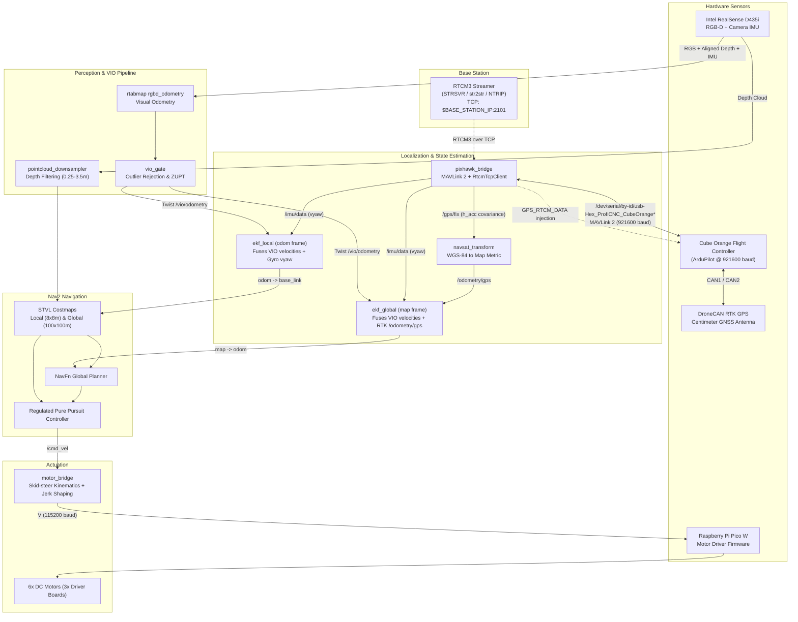

# Athena Architecture

System architecture, data flow, coordinate frames, and design decisions across the Athena rover platform.

For quickstart and operational instructions, see the [Root README](../README.md).  
For navigation implementation details, see [athena_gps_nav/ARCHITECTURE.md](../athena_gps_nav/ARCHITECTURE.md).

---

## 1. System Overview

Athena separates mobile robotics autonomy into two decoupled functional pipelines that meet only inside **Nav2**:
1. **Localization & Mapping ("Where am I?"):** Multi-sensor fusion combining Visual Odometry (VIO), high-rate IMU angular rates, and DroneCAN RTK GNSS with MAVLink RTCM3 correction injection into a dual-EKF architecture.
2. **Perception ("What is around me?"):** 3D depth point cloud processing from an Intel RealSense D435i downsampled into Spatio-Temporal Voxel Layers (STVL) for obstacle avoidance.

> [!NOTE]
> This separation ensures fault tolerance: if GNSS fixes drop or degrade, obstacle avoidance and local odometry remain completely uninterrupted.



---

## 2. Packages

| Package | Responsibility | Active |
|---|---|---|
| [`athena_gps_nav`](../athena_gps_nav/README.md) | Sensor drivers, visual odometry, dual EKF localization, RTK MAVLink bridge, costmaps, and Nav2 path planning. | Yes |
| [`athena_drive`](../athena_drive/README.md) | Motor controller bridge (`motor_bridge`), kinematics, jerk-limited velocity profiler, Pico W firmware, calibration routines. | Yes |
| [`athena_remote`](../athena_remote/README.md) | Teleoperation, waypoint manager, GPS goal dispatcher, Foxglove Studio bridge, and web captive portal. | Yes |
| `athena_slam` | *Legacy:* First-generation SLAM/GPS experiments. Deprecated due to incorrect REP-103 axes, 115200 baud link saturation, and hardcoded `/dev/ttyACM0`. | No |
| [`drive`](../drive/README.md) | *Legacy:* Deprecated motor bridge. Hardcoded `/dev/ttyACM1`. Never launch. | No |

---

## 3. End-to-End Data Flow

```
[Base Station] -> RTCM3 over TCP (port 2101)
                      ↓
[Sensors] ---------> [pixhawk_bridge] ---> /imu/data, /gps/fix
RealSense / Cube      [vio_gate] ---------> /vio/odometry
                      ↓
[Localization] ----> [ekf_local] --------> /odometry/local  (odom -> base_link)
                     [navsat_transform] -> /odometry/gps
                     [ekf_global] -------> /odometry/global (map -> odom)
                      ↓
[Nav2 Stack] ------> Costmaps (STVL) + NavFn Planner + Regulated Pure Pursuit Controller
                      ↓
[Drive & Motors] --> [motor_bridge] -----> Pico W (USB CDC) -----> 6x DC Motors
```

### Sensor & Pipeline Rates

Measured operational frequencies with the complete autonomy stack running concurrently on the Jetson:

| Topic | Source Node | Configured Rate | Delivered Rate | Description |
|---|---|---|---|---|
| `/imu/data` | `pixhawk_bridge` | 50 Hz | ~39–48 Hz | Body rates (FLU) and linear accelerations (SI units). |
| `/gps/fix` | `pixhawk_bridge` | 5 Hz | 5.0 Hz | WGS-84 position + dynamic RTK horizontal accuracy covariance ($h_{acc}$). |
| `/camera/camera/depth/color/points` | `camera` | 15 Hz | 7.0 Hz | Raw 320x240 depth point cloud (2x decimated). |
| `/camera/camera/depth/color/points_downsampled` | `pointcloud_downsampler` | ~7 Hz | 7.4 Hz | Voxel-thinned point cloud (scarcity 1:8, 0.25–3.5 m). |
| `/vio/odometry` | `vio_gate` | 15 Hz | ~10 Hz | Plausibility-filtered visual odometry twist with ZUPT pinning. |
| `/odometry/local` | `ekf_local` | 30 Hz | ~20–25 Hz | Continuous, non-jumping local odometry (`odom -> base_link`). |
| `/odometry/global` | `ekf_global` | 30 Hz | ~20–25 Hz | Metric map-frame odometry with RTK GNSS fusion (`map -> odom`). |
| `/odometry/gps` | `navsat_transform` | 10 Hz | 5.0 Hz | Map-projected metric coordinates transformed from `/gps/fix`. |
| `/local_costmap/costmap` | `local_costmap` | 2.0 Hz | 1.5 Hz | 8x8 m obstacle rolling grid in `odom` frame. |
| `/cmd_vel` | Nav2 / `teleop_mux` | 20 Hz | 20 Hz | Final velocity commands routed to `motor_bridge`. |

---

## 4. Hardware Interfaces & Addressing

All serial devices are addressed strictly via `/dev/serial/by-id/` symlinks to guarantee deterministic device binding across reboots.

| Device | Interface | Physical ID / Address | Driver / Owner | Baud Rate |
|---|---|---|---|---|
| **CubePilot Cube Orange** | USB Serial | `/dev/serial/by-id/usb-Hex_ProfiCNC_CubeOrange*` (or ArduPilot ID) | `athena_gps_nav/pixhawk_bridge` | 921600 |
| **DroneCAN RTK GNSS** | CAN Bus | CAN1 / CAN2 on Cube Orange carrier board | ArduPilot firmware (`GPS1_TYPE=9`) | CAN Bus |
| **RTK Base Station** | TCP Stream | `$BASE_STATION_IP:2101` (or `$RTCM_HOST:2101`) | `pixhawk_bridge.RtcmTcpClient` | TCP/IP |
| **Intel RealSense D435i** | USB 3.0 | Bus ID `8086:0b3a` | `/opt/ros/humble/lib/realsense2_camera` | USB 3 |
| **Raspberry Pi Pico W** | USB Serial | `/dev/serial/by-id/usb-Raspberry_Pi_Pico*` | `athena_drive/motor_bridge` | 115200 |

> [!IMPORTANT]
> Never hardcode `/dev/ttyACM*` device paths. The Cube Orange and Pico W enumerate in non-deterministic order depending on USB hub initialization timing.

---

## 5. Coordinate Frames (TF2 Tree)

```
map                         <- Published by ekf_global (absorbs RTK GNSS corrections)
 └─ odom                    <- Published by ekf_local (continuous VIO + Gyro, never jumps)
     └─ base_link           <- Chassis center, 0.10 m above ground level
         ├─ base_footprint  <- Ground projection plane (child of base_link)
         ├─ camera_link     <- RealSense D435i optical mounting (x=0.50 m, z=0.55 m)
         │   └─ camera_camera_link <- Static alias bridged for librealsense
         ├─ imu_link        <- Cube Orange IMU reference (x=0.50 m, z=0.40 m)
         ├─ gps_link        <- RTK GNSS Antenna phase center (x=0.00 m, z=0.25 m)
         ├─ nose_marker     <- Visual orientation reference (+x forward)
         └─ wheel_{front,mid,rear}_{left,right} <- 6x chassis wheel joints
```

- **`map -> odom`**: Governed by `ekf_global`. Shifts whenever RTK corrections refine global coordinates.
- **`odom -> base_link`**: Governed by `ekf_local`. Guarantees zero discontinuities for Nav2 local costmaps and path tracking.
- **`base_link -> base_footprint`**: `base_footprint` is deliberately configured as a child of `base_link` so `base_link` maintains a single parent (`odom`).

---

## 6. Key Design Decisions

| Architectural Decision | Implementation Rationale | Reference |
|---|---|---|
| **Dual-EKF Separation** | Local control loops require smooth poses without teleportation. Global waypoints require absolute coordinates. Filter 1 (`ekf_local`) never ingests GNSS; Filter 2 (`ekf_global`) absorbs GNSS corrections into `map -> odom`. | [dual_ekf_navsat.yaml](../athena_gps_nav/config/dual_ekf_navsat.yaml) |
| **RTCM3 Over-MAVLink Injection** | Only one process may hold the flight controller's serial port. `pixhawk_bridge` pulls RTCM3 frames from TCP port 2101 and injects them as MAVLink `GPS_RTCM_DATA` packets over the active telemetry stream. | `pixhawk_bridge.py` & `rtcm.py` |
| **Dynamic Covariance from $h_{acc}$** | When RTK is engaged (`fix_type >= 4`), covariance is derived directly from the receiver's reported horizontal accuracy `h_acc` clamped to `gps_rtk_sigma_floor: 0.02 m`, enabling centimeter-level EKF weighting. | [TUNING.md](../athena_gps_nav/docs/TUNING.md#rtk-gnss-and-covariance-modeling) |
| **Velocity-Only VIO Fusion** | Visual odometry (`rtabmap`) is fused exclusively as linear/angular velocities ($v_x, v_y, v_{yaw}$). If visual tracking drops and re-initializes, no discontinuous pose jumps are injected into the EKF. | `dual_ekf_navsat.yaml` |
| **Zero-Velocity Update (ZUPT)** | When `/cmd_vel` is zero for >0.5 s, `vio_gate` republishes exact zero velocities with covariance $10^{-4}$, eliminating stationary drift and costmap smearing. | `vio_gate.py` |
| **Rate-Gyro Only Fusion** | Magnetometer yaw is excluded from both filters due to onboard magnetic disturbances and compass offsets. `ekf_local` fuses IMU angular rate ($v_{yaw}$) at 50 Hz. Absolute heading aligns via RTK trajectory integration. | [TUNING.md](../athena_gps_nav/docs/TUNING.md#heading-and-imu-configuration) |
| **Frustum-Based Obstacle Clearing** | Costmaps utilize Spatio-Temporal Voxel Layers (STVL). Obstacles are cleared based on camera view frustum raytracing, preventing phantom obstacles from lingering when objects are removed. | [nav2_params.yaml](../athena_gps_nav/config/nav2_params.yaml) |
| **Custom Recovery Tree** | Standard Nav2 `Spin` (1.57 rad) and `BackUp` (0.3 m) behaviors are removed because the rover has an 87° forward camera and no rear-facing sensors. Recovery consists of costmap clearing and waiting. | `behavior_trees/athena_nav_to_pose.xml` |
| **Dual Watchdog Safety** | `motor_bridge` zeroes commands after 500 ms of `/cmd_vel` silence; Pico W firmware halts PWM if serial data pauses for 500 ms. | [FIRMWARE.md](../athena_drive/docs/FIRMWARE.md#built-in-behaviour) |

---

## 7. System Bringup Sequence

`bringup.launch.py` coordinates multi-stage startup timing to satisfy inter-node dependencies:

```bash
ros2 launch athena_gps_nav bringup.launch.py
```

| Timeline | Action / Launch File | Prerequisite / Purpose |
|---|---|---|
| **T + 0 s** | `sensors.launch.py` + `motor_bridge` | Initializes URDF, RealSense driver, `pixhawk_bridge` (MAVLink + RTCM client), and Pico serial port. |
| **T + 5 s** | `vio.launch.py` | Starts `rtabmap` visual odometry once RealSense RGB-D topics are actively publishing. |
| **T + 8 s** | `localization.launch.py` | Starts `ekf_local`, `ekf_global`, and `navsat_transform` once IMU and VIO odometry streams are valid. |
| **T + 12 s** | `navigation.launch.py` | Boots Nav2 servers (planner, controller, costmaps, lifecycle manager) after TF tree is connected. |
| **T + 15 s** | `foxglove.launch.py` | Connects Foxglove WebSocket bridge for remote visualization once all operational topics are established. |

---

## 8. Failure Modes & Degradation Handling

| Fault Scenario | System Response | Autonomous Recovery / Action |
|---|---|---|
| **Base Station TCP Disconnect** | `pixhawk_bridge` logs a warning after `rtcm_stale_warn` (10 s). | Fix seamlessly degrades from RTK Fixed -> RTK Float -> 3D Standalone GPS. Covariance widens to the HDOP model without filter divergence. |
| **GNSS Loss (e.g. Tunnel / Indoor)** | `navsat_transform` ceases publishing `/odometry/gps`. | `ekf_global` maintains dead-reckoning on VIO + IMU. Obstacle avoidance and local navigation in `odom` remain fully operational. |
| **VIO Tracking Dropout** | `vio_gate` filters anomalies; EKF briefly coasts on IMU angular rates. | RealSense recovers feature tracking automatically when scene features reappear. |
| **Camera Hardware Stall** | Depth point cloud ceases updating. | `expected_update_rate: 2.0` marks costmaps non-current within 2 seconds. The controller halts driving immediately to prevent blind movement. |
| **Flight Controller Link Break** | MAVLink heartbeat fails; IMU and GNSS streams stop. | Local odometry falls back to camera-only VIO. Global map updates halt. |
| **Host Crash or Serial Disconnect** | Serial streaming to Pico stops. | Pico W firmware watchdog trips at 500 ms and shuts off all motor PWM. |

---

## 9. Documentation Index

- [Navigation Architecture Deep Dive](../athena_gps_nav/ARCHITECTURE.md)
- [Sensor & Filter Tuning Guide](../athena_gps_nav/docs/TUNING.md)
- [Hardware & Software Testing Procedures](../athena_gps_nav/docs/TESTING.md)
- [Troubleshooting & Diagnostics](../athena_gps_nav/docs/TROUBLESHOOTING.md)
- [Drive Subsystem & Motor Calibration](../athena_drive/README.md)
- [Remote Control & Topic Reference](../athena_remote/docs/TOPICS.md)
